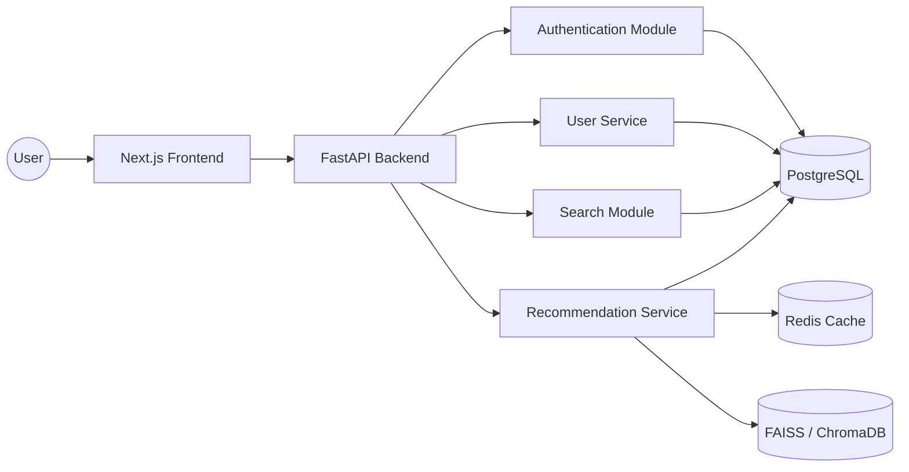
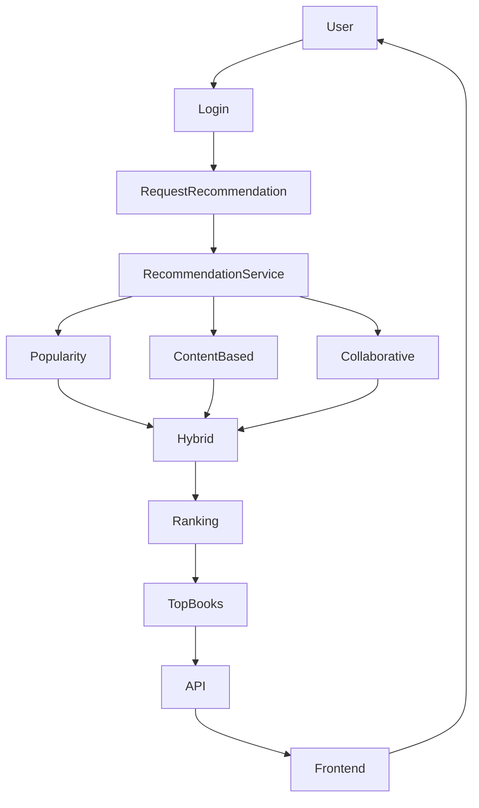
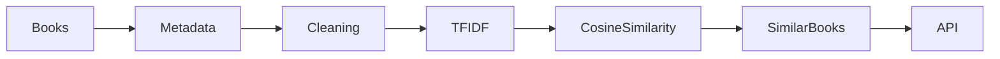
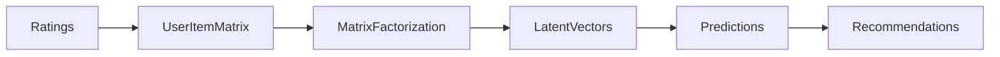
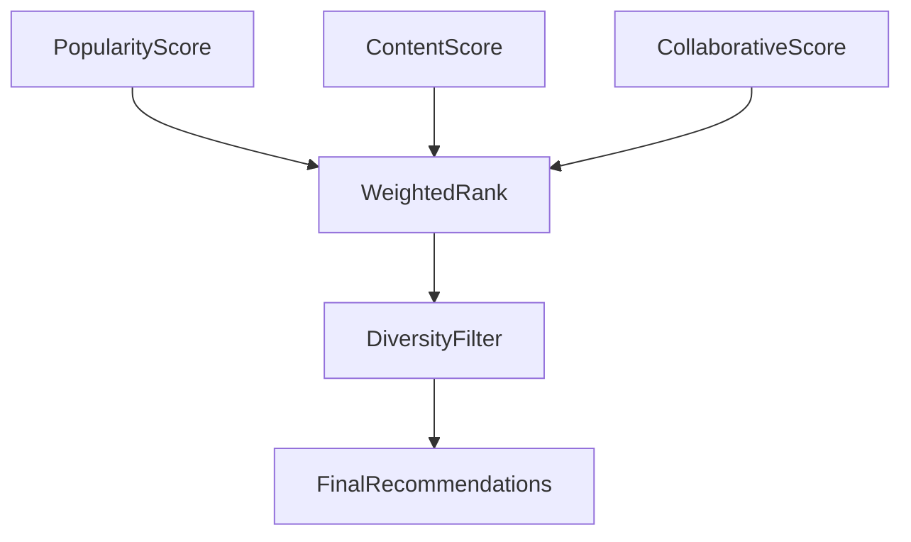
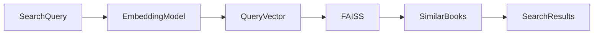
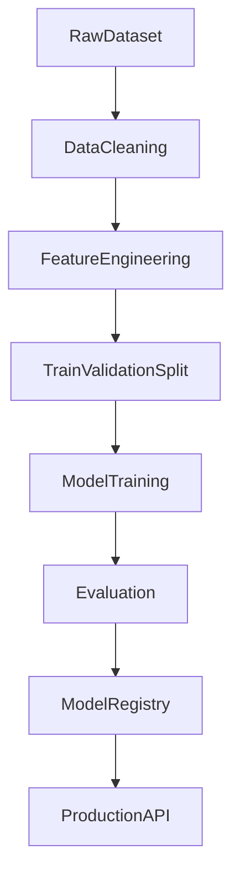
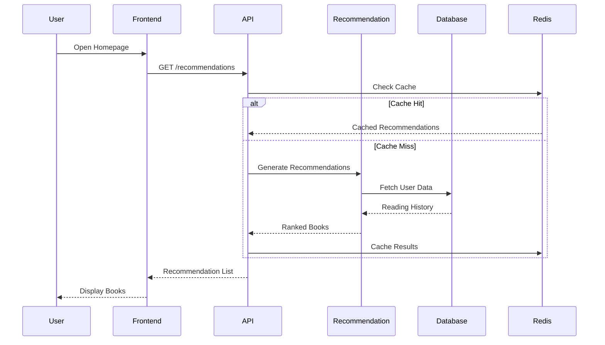
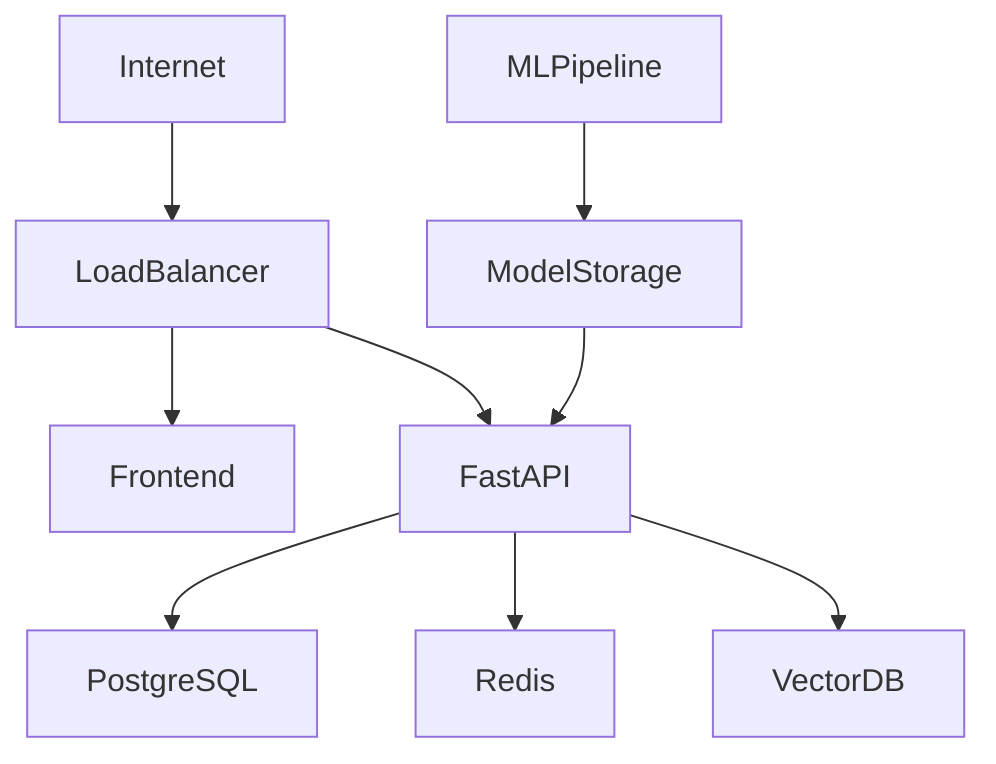

# 🏗️ System Architecture

## Overview

The Hybrid Book Recommendation System is designed using a **modular monolithic architecture**, allowing independent development of features while maintaining a single deployable application.

As the platform grows, individual modules can be extracted into independent microservices with minimal refactoring.

---

# High-Level Architecture



---

# Layered Architecture

```
Presentation Layer
──────────────────────────

Next.js Frontend
Mobile App (Future)

        │

Application Layer
──────────────────────────

REST API
Authentication
Business Logic
Recommendation API

        │

Recommendation Layer
──────────────────────────

Popularity Engine

Content-Based Engine

Collaborative Filtering

Hybrid Ranker

Semantic Search

        │

Data Layer
──────────────────────────

PostgreSQL

Redis

Vector Database

Model Files
```

---

# Recommendation Pipeline



---

# Content-Based Recommendation Flow



---

# Collaborative Filtering Workflow



---

# Hybrid Recommendation Strategy



---

# Semantic Search Pipeline



---

# Machine Learning Pipeline



---

# Request Lifecycle



---

# Database Architecture

```
Users
│
├── id
├── username
├── email
└── preferences

Books
│
├── id
├── title
├── author
├── genre
├── description
└── embedding

Ratings
│
├── user_id
├── book_id
└── rating

ReadingHistory
│
├── user_id
├── book_id
└── timestamp

Recommendations
│
├── user_id
├── book_id
└── score
```

---

# Component Responsibilities

## Frontend

- User interface
- Authentication
- Search
- Recommendation display
- Reading dashboard

---

## API Layer

- Authentication
- Request validation
- Business logic
- API documentation
- Response formatting

---

## Recommendation Service

- Recommendation orchestration
- Algorithm selection
- Score aggregation
- Result ranking

---

## Search Service

- Keyword search
- Semantic search
- Author search
- Genre filtering

---

## User Service

- User profiles
- Reading history
- Ratings
- Preferences

---

## Database

Stores

- Users
- Books
- Ratings
- Reading history
- Metadata

---

## Redis

Caches

- Popular recommendations
- User recommendations
- Frequently searched books

---

## Vector Database

Stores

- Sentence embeddings
- Book embeddings
- Semantic search vectors

---

# Deployment Architecture



---

# Future Architecture

The current implementation follows a modular monolith. As system demand increases, individual modules can evolve into independent services.

Future extraction candidates include:

- Authentication Service
- Recommendation Service
- Search Service
- Machine Learning Service
- Notification Service

These services can communicate through REST APIs or asynchronous messaging systems such as RabbitMQ or Kafka.

---

# Architecture Principles

The system is designed around the following engineering principles:

- Separation of Concerns
- Single Responsibility
- Scalability
- Maintainability
- Testability
- Fault Isolation
- Extensibility
- Performance Optimization
- Cloud Readiness
- API-First Design